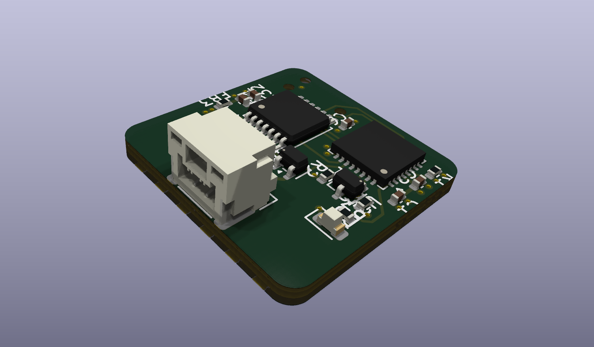

# Mjollnir-Thermocouple-Module
## Contributors
The hardware design for the module was made by Moritz Süss. The firmware for this module was made and configured by Hasan Al-Husieni and Shachi Agnihotri.

